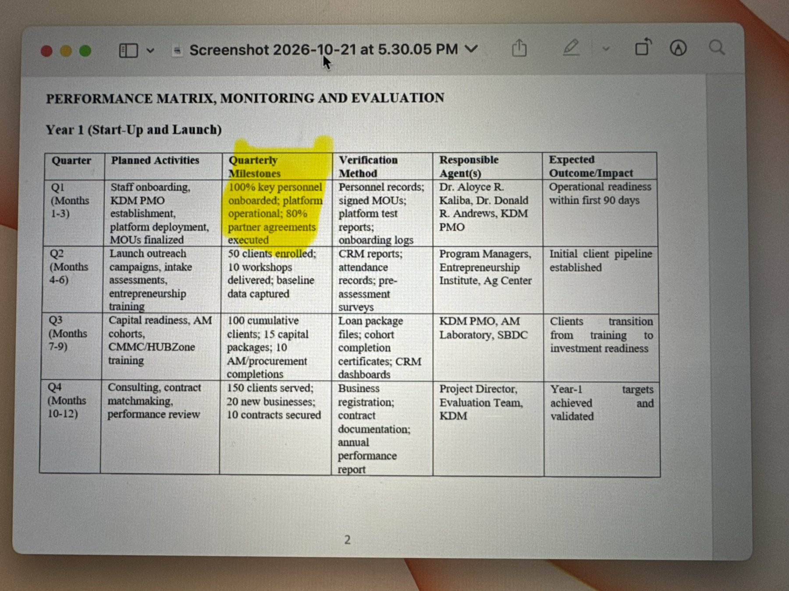

# Southern University LIFT Rural Business Center — Platform Gap Analysis

| Field | Value |
| --- | --- |
| Program | Louisiana Innovation for Thriving Rural Business (LIFT) Center — MBDA Rural Business Center Program |
| Award | MBDA-OBC-2026-00003 · Assistance Listing 11.805 · $1,275,000 · 3-year cooperative agreement (Sept 1, 2026 – Aug 31, 2029) |
| Recipient | Southern University and A&M College, College of Business (lead) |
| Platform partner | KDM & Associates, LLC (program management, intake/CRM/data-tracking/reporting platform per MOU §3) |
| Document | Gap analysis of the existing `svp-platform` codebase against Rural LIFT program requirements |
| Version | 1.0 — Draft for review |
| Date | October 25, 2026 |
| Companion document | `LIFT_System_Design.md` — design of the new modules that close the gaps identified here |

## 1. Executive Summary

The existing KDM platform (`svp-platform`, Next.js App Router + Firebase) already contains most of the building blocks the LIFT Center needs: client registration, onboarding, cohort-based learning with certificates, surveys, events and registrations, e-signature, pipeline Kanbans, SAM.gov search with AI scoring, teaming, a proposal wizard, document storage, analytics, audit logs, and a white-label deployment module.

What the platform does **not** yet have is the program layer that MBDA judges the Center on: an evidence-backed metrics engine, outcome verification, MBDA-formatted reporting, rural eligibility, grant/invoice compliance, and program-specific roles. Two partner-supplied modules — the **AI Requirements Interview Tool** and **Adams Enterprise AI Form Builder** — are not present in this codebase but are fully specified and can be ported to close the intake, consent, survey, and evidence-collection gaps (replacing the proposed JotForm purchase).

### Coverage at a glance

| Program area | Rating | Summary |
| --- | --- | --- |
| Platform deployment, branding, tenancy | [CONFIGURE] | White-label module exists; a separate LIFT deployment, MBDA branding compliance, and module toggles are needed |
| Staff onboarding and roles | [EXTEND] | User management exists; roles lack LIFT program roles and an MBDA read-only role |
| Partner agreements (MOUs) | [BUILD] | Strategic Partners list exists; no agreement-status tracking for the "80% executed" milestone |
| Client intake and consent | [EXTEND] | Client Registration closely mirrors the MBDA LOE fields; lacks rural eligibility, consent versioning, and an OMB form version |
| AI intake interview | [BUILD] | Not in codebase; port the Requirements Interview Tool with LIFT templates |
| Forms, surveys, evidence collection | [BUILD] | Survey Manager exists; port Adams Form Builder for intake/consent/evidence forms with signatures |
| Baseline and outcome data | [BUILD] | No baseline/follow-up linkage; no outcome verification workflow |
| Client lifecycle and case management | [EXTEND] | Readiness and Pipeline Kanbans exist with KDM stages; need LIFT stages and session logging |
| Referrals and service routing | [EXTEND] | Lead Routing Rules exist; need partner-destination routing and referral outcomes |
| Training, workshops, certificates | [EXTEND] | Cohorts/certificates exist but are CMMC-centric; events/webinars exist |
| Capital readiness | [BUILD] | Proof Packs and Documents can store packages; no capital pipeline or capital-infusion record |
| Procurement readiness and proposals | [EXTEND] | SAM.gov search/AI scoring is real; proposal RFP parsing and bid analysis return mock data |
| MBDA metrics and reporting | [BUILD] | Scheduled reports cover website analytics only; no program KPI engine or MBDA export |
| Grant compliance and invoicing | [BUILD] | Nothing for allowable costs, quarterly invoices, or subaward chain |
| AI assistant and alerts | [EXTEND] | AI chat (OpenAI/Ollama) exists; needs LIFT data context and off-track alerts |

### Top 10 gaps (priority order)

1. **MBDA metrics engine with evidence linkage** — the Center is scored on core measures; nothing computes them today.
2. **Outcome verification and evidence vault** — every Verification Method in the Year 1 matrix requires a documented artifact.
3. **LIFT intake with rural eligibility, consent, and signature** — the Q1 onboarding system must exist before the pilot (transcript, Oct 21: "We need a platform first before we start bringing people").
4. **Form Builder port** — replaces JotForm; supports MBDA consent signatures, pre-assessment surveys, and evidence forms.
5. **AI Intake Interview port** — accelerates onboarding of the 10–20 company pilot and the 477-client KDM database (Louisiana subset).
6. **Program roles and data isolation** — PII and business-confidential data require role-scoped access (MOU §5, §9).
7. **Grant compliance and invoice packet tracker** — first invoice due October 30; invoices are quarterly and require receipts.
8. **Proposal Accelerator (replace mocks)** — supports the "contracts secured" measure and faster SAM.gov RFI/RFP responses.
9. **LIFT Learning Hub** — rebrand archived webinars into on-demand courses with attendance and certificates.
10. **Partner agreement tracker** — Q1 milestone: 80% of partner agreements executed.

## 2. Program Baseline

### 2.1 Year 1 Performance Matrix (base requirements)

Source: `Requirements_table.heic` (converted and verified against `Screenshot 2026-10-21 at 5.30.05 PM.png`). Title: *Performance Matrix, Monitoring and Evaluation — Year 1 (Start-Up and Launch)*.

| Quarter | Planned Activities | Quarterly Milestones | Verification Method | Responsible Agent(s) | Expected Outcome |
| --- | --- | --- | --- | --- | --- |
| Q1 (Months 1–3) | Staff onboarding, KDM PMO establishment, platform deployment, MOUs finalized | 100% key personnel onboarded; platform operational; 80% partner agreements executed | Personnel records; signed MOUs; platform test reports; onboarding logs | Dr. Aloyce R. Kaliba, Dr. Donald R. Andrews, KDM PMO | Operational readiness within first 90 days |
| Q2 (Months 4–6) | Launch outreach campaigns, intake assessments, entrepreneurship training | 50 clients enrolled; 10 workshops delivered; baseline data captured | CRM reports; attendance records; pre-assessment surveys | Program Managers, Entrepreneurship Institute, Ag Center | Initial client pipeline established |
| Q3 (Months 7–9) | Capital readiness, AM cohorts, CMMC/HUBZone training | 100 cumulative clients; 15 capital packages; 10 AM/procurement completions | Loan package files; cohort completion certificates; CRM dashboards | KDM PMO, AM Laboratory, SBDC | Clients transition from training to investment readiness |
| Q4 (Months 10–12) | Consulting, contract matchmaking, performance review | 150 clients served; 20 new businesses; 10 contracts secured | Business registration; contract documentation; annual performance report | Project Director, Evaluation Team, KDM | Year-1 targets achieved and validated |

### 2.2 MBDA core and project-specific measures

| Measure | Type | Definition (source: Project Performance Worksheet) | Verification source |
| --- | --- | --- | --- |
| Clients Served | Core | Unique clients counseled/trained (≥1 session) | Intake / CRM |
| New Business Starts | Core | Post-enrollment registration + qualifying activity | Registrations |
| Capital Infusion ($) | Core | All debt/investment from all sources | Financial documents |
| Jobs Supported | Core | Jobs created or retained with Center assistance | Payroll / self-report |
| % Businesses Realizing Revenue Growth | Core | 12-month revenue increase, measured annually | Pre/post financials |
| Training activities delivered | Project | Workshops/courses delivered | Program logs |
| Capital-readiness packages | Project | Loan/investor-ready packages completed | Completed documents |
| Contracts secured (HUBZone/Prime/OEM) | Project | Awarded contracts documented | Contract documents |
| Digital adoption (e-commerce/AI users) | Project | Clients adopting e-commerce/AI tools | Surveys / usage |
| AM business-program participants | Project | Hands-on additive-manufacturing cohort | Cohort / certificate logs |
| CMMC / HUBZone / OZ readiness completions | Project | Certification-readiness completions | Cohort / certificate logs |

MBDA assesses performance **semi-annually**; the Center reports at the 6-month mark against a straight-line interpolation of annual targets and reflects rural seasonality (Project Narrative §3.b).

### 2.3 Target conflicts that must be resolved

The platform will store targets as admin-configurable values seeded from the 08/31 worksheet and the Project Narrative, but the following conflicts must be confirmed by Southern, KDM, and MBDA:

| Item | Requirements image / first worksheet | 08/31 worksheet / Narrative / Press release | Note |
| --- | --- | --- | --- |
| Y1 Clients Served | 150 | 100 | 3-yr total 650 vs 500 |
| Y1 New Business Starts | 20 | 10 | 3-yr total 100 vs 50 |
| Y1 Contracts Secured | 10 | 5 | 3-yr total 60 vs 30 |
| Y1 Capital Infusion | $750,000 (worksheets) | $375,000 (Narrative §3.b) | 3-yr $4.25M (worksheets) vs $2.125M (Narrative, press release) |
| Y1 Training activities | 40 (both worksheets) | 20 (Narrative) | 08/31 3-yr total shows 75, but annual values sum to 150 |
| Y1 Capital packages | 30 (both worksheets) | 15 (Narrative) | 08/31 3-yr total shows 70, but annual values sum to 140 |
| Revenue growth % | 40% / 60% / 80% | 20% / 30% / 40% | Year-end rate, not a quarterly sum |
| MBDA Client Intake & LOE form | OMB Control No. 0640-0002, *Expires 01/31/2026* | — | Confirm the current OMB-approved version before building the intake form |

The budget was reduced by 50% from the original submission (Keith Moore email). The transcript (Oct 21) confirms the team is planning to "minimum expectations" while pursuing budget expansion, which reinforces configurable targets.

## 3. Method and Rating Scale

The analysis was performed by inspecting the `svp-platform` codebase (routes under `app/`, APIs under `app/api/`, schemas under `lib/`), the 26 non-empty source documents in `docs/SOUTHERN Requirenments/`, the Oct 21 meeting transcript, and the two partner specifications in `docs/svp-kdm-features/`.

| Rating | Meaning |
| --- | --- |
| [READY] | Usable as-is for LIFT after data seeding |
| [CONFIGURE] | Branding, settings, copy, or toggles only — no code changes |
| [EXTEND] | Existing module needs code changes (new fields, stages, rules, or views) |
| [BUILD] | No suitable module exists — new module required (see System Design) |

Module claims are based on the presence of routes, API handlers, and schema types. Depth of each module should be confirmed in a hands-on walkthrough before build estimates are finalized.

## 4. Requirement-by-Requirement Gap Matrix

### 4.1 Year 1 Performance Matrix traceability

| ID | Requirement | Existing tool (route) | Rating | Gap | Closing module |
| --- | --- | --- | --- | --- | --- |
| REQ-Q1-01 | Staff onboarding; 100% key personnel onboarded | User Management (`/portal/admin/user-management`), Team Members, Onboarding Management | [EXTEND] | No LIFT roles; no personnel-record checklist or data-reporting training tracker | M1, M5 |
| REQ-Q1-02 | KDM PMO establishment | Command Center, Tasks, Meetings, Calendar, Rocks/EOS | [CONFIGURE] | Rebrand and seed steering-committee cadence | M1 |
| REQ-Q1-03 | Platform deployment; platform operational | White-label (`/portal/admin/white-label`), System Health, Monitoring, QA | [CONFIGURE] | Separate Firebase project, domain, MBDA branding; test reports must be exportable as evidence | M1 |
| REQ-Q1-04 | MOUs finalized; 80% partner agreements executed | Strategic Partners, Agreements, NDA e-signature (`/sign/nda/[token]`) | [BUILD] | No agreement register, status, or % executed metric | M13 |
| REQ-Q1-V1 | Verification: personnel records, signed MOUs, platform test reports, onboarding logs | Documents, Audit Logs | [BUILD] | No evidence vault linking artifacts to milestones | M10 |
| REQ-Q2-01 | Launch outreach campaigns | Communications, MailChimp, GoHighLevel workflows, LinkedIn Content | [CONFIGURE] | LIFT templates, MBDA-compliant branding, topic-based automation | M1 |
| REQ-Q2-02 | Intake assessments; 50 clients enrolled | Client Registration (`/portal/client-registration`), Client Onboarding (`/onboarding/client`) | [EXTEND] | Add rural eligibility, consent, OMB version, unified client ID, enrollment status | M2, M3, M4 |
| REQ-Q2-03 | Entrepreneurship training; 10 workshops delivered | Event Manager, Events + registrations, Webinar Creator | [EXTEND] | Workshops must count as "training activities" and attendance must feed Clients Served | M7, M11 |
| REQ-Q2-04 | Baseline data captured | Survey Manager (`/portal/admin/surveys`) | [BUILD] | No baseline/follow-up pairing per client; no metric mapping | M2, M10 |
| REQ-Q2-V1 | Verification: CRM reports, attendance records, pre-assessment surveys | Analytics, event check-in | [BUILD] | Program KPI reports do not exist (scheduled reports are Vercel site analytics only) | M11 |
| REQ-Q3-01 | Capital readiness; 15 capital packages | Proof Packs, Documents, member attachments | [BUILD] | No capital package workflow, lender pipeline, or capital infusion record | M8 |
| REQ-Q3-02 | AM cohorts; CMMC/HUBZone training; 10 AM/procurement completions | Cohorts (admin/instructor/SME), Certificates, Consortium Readiness | [EXTEND] | Cohorts are CMMC-centric; need LIFT tracks and completion → metric linkage | M7 |
| REQ-Q3-03 | 100 cumulative clients | Leads, Customers, Kanbans | [BUILD] | No de-duplicated, cumulative Clients Served count | M5, M11 |
| REQ-Q3-V1 | Verification: loan package files, cohort certificates, CRM dashboards | Documents, Certificates, Analytics | [BUILD] | Evidence must be attached to the outcome it proves | M10, M11 |
| REQ-Q4-01 | Consulting | Meetings, Bookings, Availability, One-to-One | [EXTEND] | Session logs need client, advisor, service area, hours | M5 |
| REQ-Q4-02 | Contract matchmaking; 10 contracts secured | SAM.gov Search/Monitor, AI matching, Teaming, Pursuits, Introductions | [EXTEND] | Award documentation and contract-value capture tied to client | M9, M10 |
| REQ-Q4-03 | 20 new businesses | Client record | [BUILD] | Registration evidence + "post-enrollment" date logic | M10 |
| REQ-Q4-04 | Performance review; annual performance report | Analytics, Scheduled Reports | [BUILD] | Annual and semi-annual report packs with interpolation and evidence index | M11 |

### 4.2 Additional requirements from MOU, narrative, emails, and transcript

| ID | Requirement | Source | Existing tool | Rating | Closing module |
| --- | --- | --- | --- | --- | --- |
| REQ-X-01 | Intake, CRM, data-tracking, reporting platform that assesses needs, routes clients, monitors progress, reports against MBDA measures | MOU §3 | Multiple | [EXTEND] | M3–M6, M11 |
| REQ-X-02 | Avoid duplication; coordinate referrals with MBDA, SBA, SBDC, APEX, EDOs, lenders | MOU §5 | Lead Routing Rules | [EXTEND] | M6 |
| REQ-X-03 | Protect business, financial, technical, cybersecurity, and PII data; authorized access | MOU §5, §9 | Firestore rules, roles | [EXTEND] | Cross-cutting RBAC |
| REQ-X-04 | Records support federal reporting, audit readiness (2 CFR 200) | MOU §4, §8, §9 | Audit Logs | [EXTEND] | M10, M12 |
| REQ-X-05 | No federal funds for direct loans, grants, equity, construction, lobbying | MOU §8 | — | [BUILD] | M8, M12 guardrails |
| REQ-X-06 | Separate MBDA domain, branding, email | Email to Keith/Pam (Q1) | White-label | [CONFIGURE] | M1 |
| REQ-X-07 | Capture client consent signatures (previously JotForm) | Email to Keith/Pam (Q2); transcript | NDA e-signature | [EXTEND] | M2, M4 |
| REQ-X-08 | Monthly metric reporting; platform maintained throughout program | Email to Keith/Pam (Q3) | — | [BUILD] | M11 |
| REQ-X-09 | Data captured at intake and every touchpoint; AI-queryable; flag off-track clients | Narrative §3.a | AI Chat | [EXTEND] | M5, M15 |
| REQ-X-10 | Single site for all activities; LMS; status by organization; notifications; scheduled reports; AI chat | Transcript (Nelinia Varenas) | Multiple | [EXTEND] | M1, M5, M7, M15 |
| REQ-X-11 | Webinar archive rebranded (MBDA / Rural Business Center / LIFT / Southern) as online training with sign-up and feedback | Transcript | Webinars, Webinar Creator | [EXTEND] | M7, M14 |
| REQ-X-12 | Pilot cohort (10–20 companies) onboarded before November; Louisiana clients from KDM's 477-client database | Transcript | Admin Users, Consortium Members | [EXTEND] | M3, M4 |
| REQ-X-13 | Out-of-scope (fee-based) services published with fee structures | Transcript, OZ email | Pricing, Stripe | [CONFIGURE] | M1 (separate from grant services) |
| REQ-X-14 | MBDA logo usage per current branding guide (MBDA presence no smaller than Center's) | Transcript (Pam Ramos) | Header/Footer, branding | [CONFIGURE] | M1 |
| REQ-X-15 | Quarterly invoices with receipts; first invoice Oct 30; subaward/PO before invoicing; V+ and Pam invoice KDM, KDM invoices Southern | Transcript, E3S email | — | [BUILD] | M12 |
| REQ-X-16 | On-demand content for 500 clients over 3 years: webinars, podcasts, social media, mentoring | OZ email | Resources, Blog, Webinars | [EXTEND] | M7 |
| REQ-X-17 | Participant feedback on business impact | Transcript (Dr. Mensah) | Testimonials | [EXTEND] | M14 |
| REQ-X-18 | Faster SAM.gov RFI/RFP responses for small businesses | Request | Proposals wizard, SAM.gov AI | [EXTEND] | M9 |

## 5. Detailed Findings by Area

### 5.1 Tenancy, branding, and module scope — [CONFIGURE]

- A **White-label Deployments** module exists (`/portal/admin/white-label`, collections `whiteLabelDeployments`, `deploymentAnalytics`, `deploymentAuditLogs`).
- Decision: LIFT runs as a **separate deployment** with its own Firebase project so federal/PII client data is never co-mingled with KDM consortium data.
- MBDA branding compliance requires a configurable logo lockup and a policy check (request the current MBDA branding guide and keep the request on record, per transcript).
- KDM-only modules must be disabled (see §9).

### 5.2 Roles and access — [EXTEND]

- `TeamMemberDoc.role` is limited to `admin | team | affiliate | consultant | sme_user`; server auth also recognizes `svpRole === "platform_admin"`.
- LIFT requires: Principal Investigator, Project Director, Program Manager, KDM PMO, Partner Advisor (SBDC, AM Lab, Law Center, Ag Center, GRS), Instructor, Evaluator, Client, and MBDA Viewer (read-only reports).
- Financial and PII fields (revenue, payroll, loan documents, ethnicity/disadvantage certification) need field-level protection.

### 5.3 Intake and consent — [EXTEND]

- `ClientRegistrationDoc` already mirrors the **MBDA FPC Client Intake & Letter of Engagement**: ownership, title, ethnicity, minority certification, address, SAM/CAGE/DUNS, NAICS, revenue, applying-as, out-of-state, in-house BD, acquisition method, referral, capability statement, teaming, resources to invest, needs.
- Missing for LIFT: parish and rural eligibility determination; MBE/disadvantage certification attestation (15 U.S.C. §9501); privacy disclosure acceptance; Acceptance of Client Relationship terms; signature with timestamp; **OMB form version**; unified client ID; enrollment date (needed for "post-enrollment" business starts); service-area selection; UEI (the form still references DUNS, which SAM.gov has replaced with UEI).
- Copy currently says "Register with KDM & Associates" and must be rebranded.

### 5.4 Baseline, outcomes, and evidence — [BUILD]

- Survey Manager (including AI survey creation and templates) exists, but responses are not linked to a client baseline record or to a 6/12-month follow-up.
- No outcome records exist for capital infusion, jobs, contracts, new starts, or revenue growth, and there is no staff verification step.
- The Year 1 matrix names a verification artifact for every milestone; the platform needs an evidence vault keyed to metric and period.

### 5.5 Lifecycle and case management — [EXTEND]

- `Readiness Kanban` and `Pipeline Kanban` exist with KDM consortium stages.
- LIFT stages: Inquiry → Intake Submitted → Eligible → Assessed → Service Plan → In Services → Outcome Pending Verification → Outcome Verified → Alumni.
- Session logging must capture client, advisor, partner, service area, date, duration, and notes; ≥1 session defines a Client Served.

### 5.6 Referrals and routing — [EXTEND]

- `Lead Routing Rules` (`/portal/admin/routing-rules`, collection `routingRules`) assigns leads to team members.
- LIFT needs routing to partner destinations (SBDC, AM Lab, Law Center, Ag Center, Entrepreneurship Institute, lenders, APEX Accelerator, GRS mentor-protégé network, V+), referral acceptance, and referral outcome feedback to prevent duplicated services.

### 5.7 Training and learning — [EXTEND]

- Cohorts (admin, instructor, SME views), curriculum, discussion, assessments, and certificates exist; catalog copy and checkout flows are CMMC-specific (`/cohorts` "CMMC Training Courses", `/checkout/cmmc-cohort`).
- Events (`EventRegistrationDoc` with check-in) and Webinar Creator exist; event registrations are payment-oriented.
- LIFT needs free, grant-funded tracks: Entrepreneurship, Capital Readiness, AM Business Program, CMMC/HUBZone/OZ Readiness, Digital/AI Adoption; webinar-to-course conversion; attendance that feeds Clients Served and Training Activities.

### 5.8 Capital readiness — [BUILD]

- Proof Packs (shareable bundles of company documents) and Documents can hold loan package files.
- Missing: capital package checklist, lender/investor pipeline, capital infusion record with source and verification, and the MOU guardrail that Center funds are never used for direct loans, grants, or equity.

### 5.9 Procurement readiness and proposals — [EXTEND]

- **Real AI today:** `lib/samgov-ai.ts` (opportunity scoring, teaming partner recommendation, teaming pitch, NAICS suggestions); `/api/ai/chat` (OpenAI or Ollama, with fallback).
- **Mock or placeholder today:** `/api/ai/rfp-processing` returns hard-coded/random results (`generateMockRfpProcessing`); `/api/ai/bid-analysis` returns `generateMockBidAnalysis`; `/api/ai/analyze-document` and `/api/ai/analyze-screenshot` fall back to mock analysis; `/api/ai/rewrite-content` is a TODO.
- The Proposals wizard (`/portal/proposals`, types in `lib/types/proposal.ts`) supports `rfp_response` and `rfi_response`, sections, deliverables, and signature status.
- See §7 for the LIFT use of the proposal generator.

### 5.10 Reporting — [BUILD]

- `AnalyticsScheduledReportDoc` schedules **Vercel website analytics** (visitors, pageviews) — not program metrics.
- Missing: KPI definitions, configurable targets, quarterly and semi-annual roll-ups, straight-line interpolation, rural seasonality, evidence index, MBDA export, and monthly internal reports.
- The prior MBDA center model used a Salesforce-based metric evaluation that determined the score (transcript); the MBDA designated performance system format for this award must be confirmed.

### 5.11 Grant compliance and invoicing — [BUILD]

- Nothing exists for allowable-cost tagging, quarterly invoice packets, receipts, subaward/PO status, or the invoice chain (V+ and Pam Ramos → KDM → Southern Sponsored Programs).
- KDM's fiscal year is calendar-year; the subaward form question should be answered per Sponsored Programs guidance (transcript).

### 5.12 AI assistant and alerts — [EXTEND]

- AI chat and Site Assistant exist; notifications (`userNotifications`) exist.
- LIFT needs program-data context (status of any client, metric progress) with role-scoped retrieval, off-track client alerts, and scheduled briefings to leadership.

## 6. AI Requirements Interview Tool in the Rural LIFT Program

Source specification: `docs/svp-kdm-features/Interviewtool/inverviewtool.md` (Reusable Requirements Interview Tool, current implementation "Adams Harness / Interview Ideas to Solutions").

### 6.1 Current state — [BUILD] (port)

None of the tool's assets (`lib/adams-harness/*`, `/interview`, `/portal/solutions/*`, `/portal/admin/interviews`, `/api/public/interview/*`, `/api/adams-harness/*`) exist in this repository. The tool must be ported. Note that this repository's `hermes/` folder documents a Telegram operations agent; it is not the "Hermes" OpenAI-compatible endpoint the interview tool uses, so the port should use the spec's provider-agnostic `AI_BASE_URL` / `AI_API_KEY` / `AI_MODEL` configuration (the repo already includes the `openai` SDK).

### 6.2 Why it fits LIFT

The tool is designed to be re-templated: coverage topics, fact schema, output schema, branding, categories, and post-completion actions are configuration (FR-1, FR-5, FR-10, §13). It supports public (no sign-in) and authenticated modes, one question per turn, attachments (Excel, Word, PDF, PowerPoint, text), deterministic fallback when AI is unavailable, versioned outputs with SHA-256 canonical hash, approval workflow, and audit events — all of which match federal record-keeping needs.

### 6.3 LIFT interview templates

| Template | Audience | Categories (replace "departments") | Coverage topics | Output | Post-actions |
| --- | --- | --- | --- | --- | --- |
| **LIFT Client Intake Interview** | Public + authenticated | LIFT service areas: Business Formation & Entrepreneurship, Capital Readiness, Procurement Readiness (CMMC/HUBZone/OZ/Mentor-Protégé), Advanced Manufacturing (AM Lab), Digital & AI Adoption, Agriculture | Business identity; ownership & MBE eligibility; location/parish; industry & NAICS; stage (idea / startup / operating); revenue & employees; capital needs; procurement history & registrations; certifications; digital tools; #1 need; barriers; goals (12-month); preferred services; referral source | Draft Client Intake Record + Needs Assessment + recommended Service Plan | Create draft client (M4), prefill MBDA LOE consent form (M2), route referrals (M6), schedule first advisor session |
| **Baseline Assessment Interview** | Authenticated client | Same | Revenue (last 12 months), jobs (FT/PT), payroll, capital raised to date, contracts held, digital adoption, certifications | Baseline Snapshot | Create baseline record (M10) |
| **Outcome Check-in (6 and 12 months)** | Authenticated client | Same | Revenue change, jobs created/retained, capital obtained (source, amount), contracts won, new registration, tools adopted | Outcome Claim set | Create outcome claims pending verification (M10); request evidence upload via form (M2) |
| **Advisor Session Debrief** | Staff / partner advisor | Service area | Services delivered, time spent, client commitments, next steps, referrals | Session Log | Append touchpoint (M5), update service plan |
| **Partner Intake** | Partner organization | Partner type (lender, SBDC, prime, OEM, university unit) | Services offered, eligibility, referral contact, capacity, data-sharing terms | Partner Profile | Create partner record and agreement task (M13) |
| **Platform/Process Requirements** (original use) | Southern and KDM staff | Center units | The spec's 15 discovery topics | Versioned specification / PRD | Feed platform backlog for later phases |

### 6.4 Program benefits

- **Faster onboarding for the pilot and Q1/Q2 enrollment** — a conversational, mobile-friendly interview lowers the barrier for rural owners compared with a long form, and can run in a low-bandwidth, one-question-at-a-time layout.
- **Better baseline data** — structured facts with coverage tracking prevent missing baseline fields that later undermine revenue-growth and jobs measures.
- **Attachment evidence** — owners can upload financial statements, capability statements, or loan documents; the analyzer extracts summaries and generates follow-up questions.
- **Auditability** — every interview, output version, approval, and action is audited with a canonical hash.

### 6.5 Required LIFT controls

- **Human confirmation before data becomes official.** The interview produces a *draft* client record; staff or the client confirms, and the MBDA consent/LOE is signed through the Form Builder before the client counts as enrolled.
- **No eligibility decisions by AI.** The AI may flag likely rural/MBE eligibility; eligibility is decided by rule (parish lookup) and staff.
- **Privacy disclosure** that responses are shared with MBDA as described in the MBDA privacy disclosure; minimize data sent to the AI provider (NFR-3).
- **Prompt-injection and abuse protections** from the spec (§15): rate limits, CAPTCHA for public starts, hashed session tokens.
- **Do not port the module-build/deploy adapter** (FR-15) into the LIFT site; the PRD staging/deploy flow is only relevant to the "Platform/Process Requirements" template and should remain in the KDM build environment.

### 6.6 Metrics supported

Clients Served (intake → first session), baseline data captured (Q2), Jobs Supported, Revenue Growth, Capital Infusion, Contracts Secured (via outcome check-ins), and interview observability (completion rate, time to readiness).

## 7. Proposal Generator in the Rural LIFT Program

### 7.1 Current state — [EXTEND]

| Asset | Status |
| --- | --- |
| `/portal/proposals` 8-step wizard; types `rfp_response`, `rfi_response`, `grant`, `mou`, `oem_supplier_readiness` | Present |
| SAM.gov search, monitor, sync cron (`/api/cron/samgov-sync`), AI opportunity scoring, NAICS suggestions, teaming recommendations and pitch (`lib/samgov-ai.ts`) | Present, real AI |
| Teaming requests/alerts, Pursuits, Proof Packs, Reps & Certs | Present |
| Solicitation parsing (`/api/ai/rfp-processing`) | **Mock** — returns fixed NAICS, random set-asides, sample requirements |
| Bid / go-no-go analysis (`/api/ai/bid-analysis`) | **Mock** |
| Document analysis (`/api/ai/analyze-document`) | Partial; falls back to mock |
| Compliance matrix (Section L/M), capability library, sources-sought/RFI templates, Word export | Not present (`docx` package is installed and can be used for export) |

### 7.2 LIFT use: helping small businesses respond faster to SAM.gov RFIs and RFPs

**Workflow**

1. **Match** — SAM.gov opportunities are scored against the client's verified capability profile (existing AI scoring), filtered to Louisiana/rural-relevant set-asides (HUBZone, 8(a), WOSB, SDVOSB, Total Small Business).
2. **Ingest** — the client or advisor clicks "Respond"; the platform pulls the notice and attachments from SAM.gov and extracts text (`pdf-parse` is installed).
3. **Analyze** — real AI replaces the mocks: key dates, NAICS, set-aside, evaluation factors, mandatory requirements, certifications (CMMC level, ISO/AS9100), page limits, submission instructions.
4. **Go/No-Go** — fit score with gaps (missing certifications, past performance, capacity) and recommended teaming partners from the consortium and partner network (existing teaming AI).
5. **Compliance matrix** — every "shall/must" requirement and Section L instruction mapped to a response section and owner.
6. **Draft** — AI drafts from the client's **capability library** (company profile, capability statement, past performance, certifications, staff resumes, proof packs):
   - RFI / Sources Sought response (capabilities, relevant experience, answers to government questions) — the highest-volume, fastest win for small businesses;
   - Capability statement (one page);
   - RFP volumes (technical approach outline, management, past performance) with clear "advisor review required" markers.
7. **Review** — LIFT advisor (KDM procurement readiness lead or SBDC/APEX partner) reviews in a queue; the client approves.
8. **Export and submit** — Word/PDF export; the client submits through the official channel; the platform records submission.
9. **Outcome** — award recorded with contract documentation → verified "Contract Secured" (M10/M11).

**Guardrails**

- The client is the offeror; the Center coaches and reviews. AI drafts are labeled and require human review.
- No fabricated past performance or certifications — drafts may only cite capability-library facts.
- Respect solicitation page limits and formatting; never upload controlled/CUI documents to the AI provider.
- Services delivered count as counseling time (Clients Served); awards count only after verification.

**Program metrics added**

Responses submitted per client, median time from notice to draft, RFI/sources-sought responses (leading indicator), proposals submitted, win rate, and contracts secured.

## 8. Adams Enterprise AI Form Builder in the Rural LIFT Program

Source specification: `docs/svp-kdm-features/formbuilder/Adams form builder.md` (Enterprise AI Form Builder & Data Analytics Studio).

### 8.1 Current state — [BUILD] (port)

None of the builder's files (`lib/form-builder/*`, `components/portal/form-builder-renderer.tsx`, `/portal/form-builder`, `/forms/[slug]`, `/api/form-builder/*`, `/api/public/forms/[slug]`) exist in this repository. Dependencies: `recharts` and `pdf-parse` are installed; **`jsPDF` and a Word (`.docx`) parser are not** and would be new dependencies (or PDF generation can reuse the existing `puppeteer`).

### 8.2 Why it fits LIFT (replaces JotForm)

The team rejected JotForm because the program needs "multiple tables" and tracking across onboarding, LMS, and members (transcript). The builder provides three presentation modes (standard, conversational, imported PDF/Word overlay), 20+ controls including `signature`, `file_upload`, `likert_scale`, `nps`, `repeating_table`, and `calculated`, an AI form generator, an **AI reporting optimizer** that converts free text into dimensions and metrics, drop-off analytics, branded PDF of each submission, and a public REST/webhook API.

The **document overlay mode** is particularly valuable: the official MBDA Client Intake & LOE PDF can be imported and signed as-is, preserving the government form while capturing structured data.

### 8.3 LIFT form catalog

| Form | Mode | Key controls | Feeds | Metric |
| --- | --- | --- | --- | --- |
| MBDA Client Intake & Letter of Engagement (versioned by OMB control number) | Document overlay | Identity, MBE attestation, privacy agreement, acceptance of client relationship, `signature` | Client record (M4) | Clients Served (after first session) |
| Rural Eligibility Attestation | Standard | Address, parish `platform_lookup`, `yes_no` | Eligibility decision (M4) | — |
| Pre-Assessment / Baseline Survey | Conversational | `currency` revenue, `number` jobs, `likert_scale` readiness, `multi_select` needs | Baseline (M10) | Baseline data captured |
| Workshop Registration & Attendance | Standard | Event lookup, `yes_no` consent to contact | Events/attendance (M7) | Training activities, Clients Served |
| Workshop Feedback | Conversational | `nps`, `rating_stars`, `likert_scale`, `long_text` | Feedback & impact (M14) | Service quality |
| Outcome Evidence Submission | Standard | Outcome type `dropdown`, `currency`, `date`, `file_upload` | Evidence vault (M10) | All core measures |
| Capital Readiness Checklist | Standard | `repeating_table` documents, `file_upload` | Capital package (M8) | Capital-readiness packages |
| Advisor Session Log | Standard | Client lookup, service area, `number` hours, `long_text` | Touchpoints (M5) | Clients Served |
| Partner Agreement / MOU Intake | Document overlay | Partner details, `signature` | Agreements (M13) | % partner agreements executed |
| Staff Onboarding Acknowledgment | Standard | Data-reporting training, confidentiality, `signature` | Personnel records (M1) | 100% personnel onboarded |

### 8.4 Required adaptations for LIFT

- **Lookup sources:** replace Adams sources (`safety_sites`, `user_assets`, etc.) with LIFT sources: `lift_clients`, `parishes`, `service_areas`, `advisors`, `partners`, `cohorts`, `events`.
- **Integrations:** enable internal routing to LIFT modules (client record, evidence vault, touchpoints, notifications, calendar) and `outbound_webhook`; disable construction/field-service connectors (Procore, Autodesk ACC, ServiceTitan, QuickBooks) unless needed.
- **Security fix required before production.** The spec's Firestore rules allow `read: if true` on `platformForms`, and each form document stores an `apiKey` — this would expose API keys publicly. Public reads must go through a server API that returns a sanitized schema; keys must be hashed and stored separately. Submissions with `create: if true` must be rate-limited and validated server-side.
- **Storage of signatures and files:** the spec stores Base64 data URIs in Firestore documents, which risks the 1 MiB document limit and puts PII in the database. Store files and signature images in Firebase Storage with access rules; keep only references and hashes in Firestore.
- **E-signature audit trail:** capture consent text, form version, signer identity, timestamp, IP/user agent, and a hash of the signed content to support ESIGN/UETA-style evidence.
- **Form versioning:** submissions must reference the exact form version (for OMB-controlled forms and consent language).
- **Field mapping:** add declarative field-to-collection mapping so one submission can write to multiple LIFT records (the "multiple tables" requirement).
- **Interview integration:** the AI Intake Interview can prefill Form Builder forms; the form remains the signed, official record.

## 9. Modules to Disable on the LIFT Site

| Module | Reason |
| --- | --- |
| Consortium membership tiers, pricing, founding-member checkout | KDM commercial offering; not a grant-funded service |
| Affiliate commissions, revenue config, payouts, settlements | Commission flows must not mix with federal program services |
| Apollo and ThomasNet contact purchasing | Purchased contact data and cost exposure |
| Sourcewell, TBMNC initiatives, KDM-specific marketing pages | Not in LIFT scope |
| Developer tools (seeders, price testing, migrate-auth, init-collections) | Not for production program staff |
| CMMC paid cohort checkout | LIFT training is free; paid follow-on work must be clearly separated and optional |

Stripe and the Pricing page may remain only for clearly labeled **out-of-scope, fee-based services**, separate from grant-funded services.

## 10. Risk Register

| Risk | Impact | Likelihood | Mitigation |
| --- | --- | --- | --- |
| Zero results in Q1 because the platform is not ready | High | Medium | Phase 0 pilot: intake form + signature + webinar archive by Nov 10 |
| Unconfirmed targets and MBDA reporting format | High | High | Configurable targets; reporting adapter; confirm with MBDA at orientation |
| PII/confidential data exposure | High | Medium | Separate deployment, role-scoped rules, Storage for files, audit |
| AI hallucination in proposals or intake | Medium | Medium | Human review gates, capability-library-only drafting, labeled AI output |
| Ported modules carry Adams-specific assumptions | Medium | High | Port per spec portability phases; remove Adams connectors |
| Invoice delays (subaward/PO not yet issued) | High | High | Compliance tracker with PO status; evidence packets ready |
| MBDA branding non-compliance | Medium | Medium | Request current branding guide; configurable lockup |
| Budget reduction limits build capacity | High | High | Phase by invoice milestones; reuse existing modules first |

## 11. Prioritized Remediation Roadmap

| Phase | Window | Modules | Outcome |
| --- | --- | --- | --- |
| **Phase 0 — Pilot readiness** | Now → Nov 10 | M1 Tenant & Branding; M2 Form Builder (intake/consent form only); M4 Intake & Eligibility (basic); M7 webinar archive | Pilot companies onboarded with signed consent; Q1 evidence |
| **Phase 1 — Public launch** | → ~Nov 19 (mobile CAVE launch / AM Lab ribbon cutting) | M3 AI Intake Interview; M5 Lifecycle; M6 Routing; M13 Agreements; M15 Assistant (basic) | Public intake, pipeline visibility, partner tracking |
| **Phase 2 — Q2 operations** | Months 4–6 | M8 Capital; M9 Proposal Accelerator; M10 Evidence Vault; M11 Metrics & Reporting; M12 Grant Compliance | Evidence-backed metrics and semi-annual report |
| **Phase 3 — Optimization** | Months 7+ | M14 Feedback & Impact; M15 alerts and briefings; enhancements | Adaptive management and sustainability |

## 12. Open Questions

1. Which Year 1 targets are authoritative (see §2.3)?
2. What is MBDA's designated performance system for this award, and what is its import format and cadence?
3. Which OMB-approved version of the Client Intake & LOE form must be used, and must clients sign it, or is electronic consent acceptable?
4. Which geography defines "rural" for eligibility (e.g., USDA, Census, or MBDA definition), and are urban-parish clients ever eligible?
5. Who owns the LIFT data after August 31, 2029, and what retention period applies?
6. Which LIFT staff roles exist, and who may see financial and PII fields?
7. Which partners need platform logins versus email referrals only?
8. Which AI provider and model are approved for client data, and may client documents be sent to it?
9. Are interview and form responses from the KDM pilot companies counted as LIFT clients (and with what consent)?
10. What are the out-of-scope services and fee structures, and who invoices them?
11. Which existing webinars are cleared for rebranding, and who approves MBDA logo usage?
12. What is the quarterly invoice schedule after October 30, and what supporting documentation does Sponsored Programs require?

## Appendix A. Source Documents

| File | Used for |
| --- | --- |
| `Requirements_table.heic`, `Screenshot 2026-10-21 at 5.30.05 PM.png` | Year 1 Performance Matrix (baseline) |
| `LIFTProjectPerformanceWorksheetFinal.pdf`, `..._08_31.pdf` | Quarterly targets and definitions |
| `MBDA Rural Center Performance metrics.pdf` | Theory of change, measures, start-up plan |
| `MOU_KDM and Associates_Southern_University_LIFT_Rural_MBDA_Center.docx.pdf` | Roles, data, compliance |
| `Brian-Stitt-MBDAFPC-Client-LOE.pdf` | MBDA intake form fields |
| `Edited C. Sills - DRAFT MBDA LIFT Rural Center Press Release_09_29_26 (1).docx` | Award amount, 3-year goals, leadership |
| `email content.md.txt`, `southern_email_keith.txt.txt`, `Keith_email_brian.txt`, `southern_oportunity_zone_email.txt.txt`, `southern_E3S_email.txt` | Branding, consent, reporting, content, budget |
| `southern_transcript.md` (Oct 21 meeting) | Platform priorities, pilot, invoicing, branding |
| `Letter of Support -GRS.pdf`, `2026 Southern_University_Federal_Contracting_Capability_Brief.pdf` | Partner capabilities |
| `docs/svp-kdm-features/Interviewtool/inverviewtool.md` | AI interview tool specification |
| `docs/svp-kdm-features/formbuilder/Adams form builder.md` | Form builder specification |

ITAC, Opportunity Zone media, and E3S revenue-sharing materials were reviewed but are out of scope for this analysis. Empty files: `southern_transcript2.txt.txt`, `brian_response_southern.txt`, `southern_meet_KDM.txt`, `southern_press_release.txt`.

## Appendix B. Requirements Table (source image)

